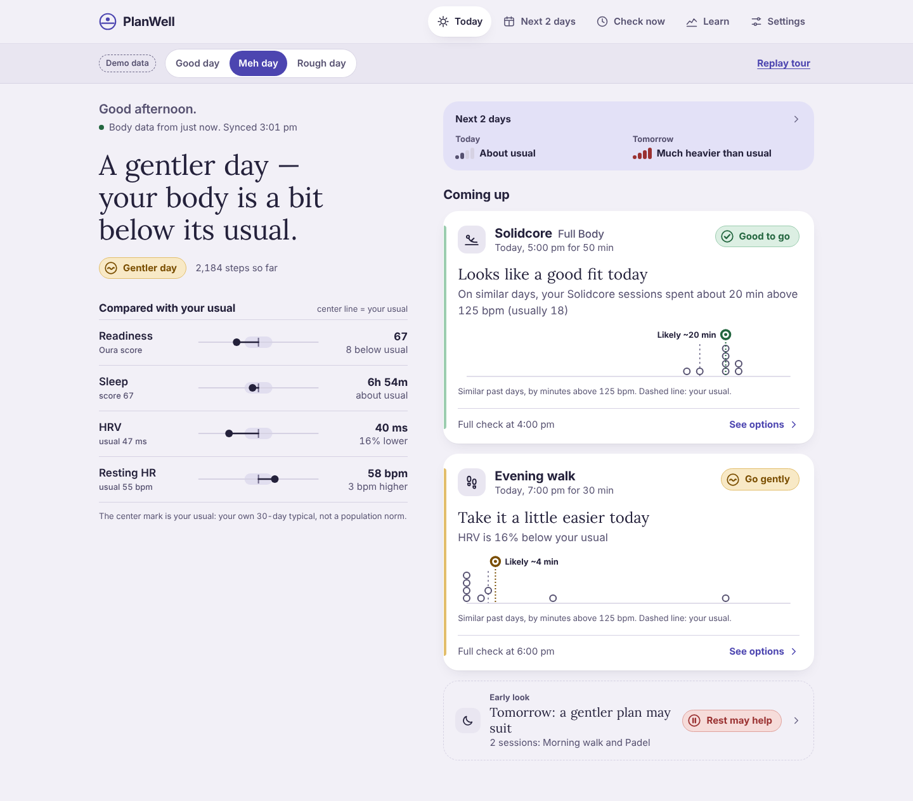
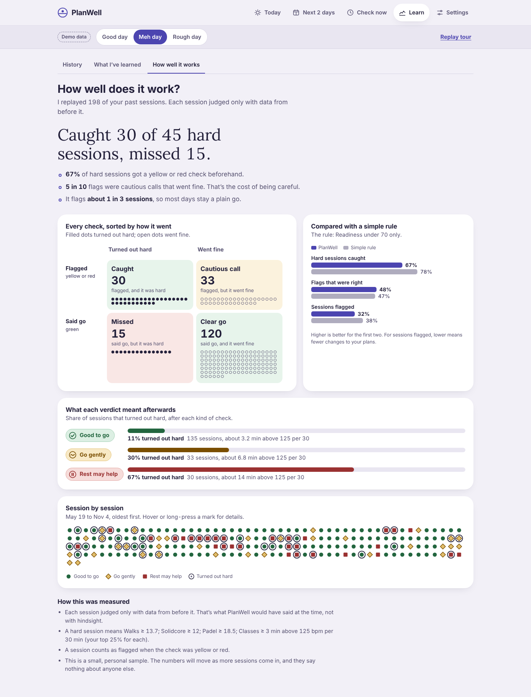
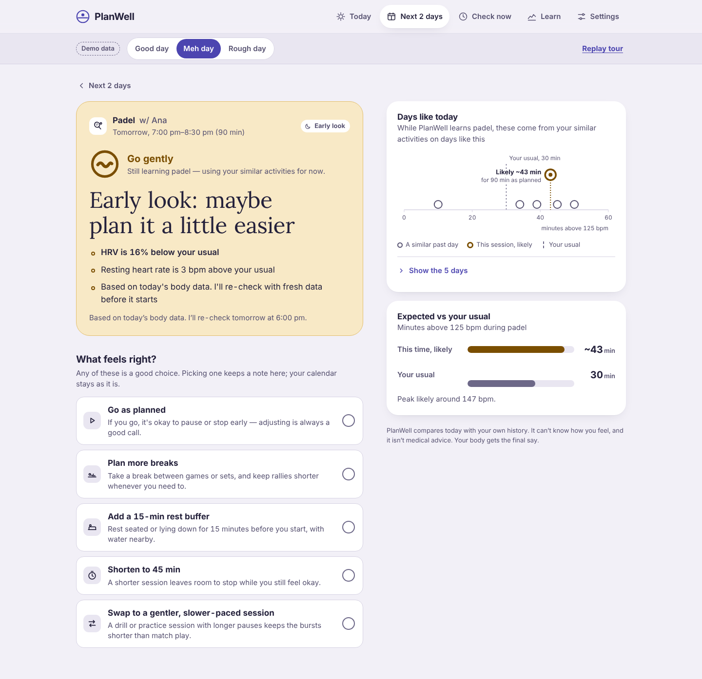
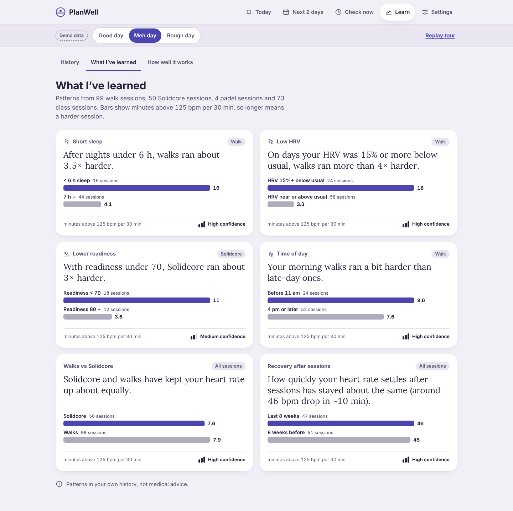

# PlanWell

**A personal, accessibility-first pre-activity check for living with POTS.**

About an hour before a walk, Solidcore class or padel game in my Google Calendar, PlanWell compares
today's body state from my Oura ring with my own past sessions on similar days, then gives a calm
green / yellow / red check with plain-language reasons and gentle options: go as planned, shorten,
swap to a gentler version, move earlier, or add a rest buffer.

**[▶ Try the live demo](https://melisgurbuz8.github.io/planwell/)**: no install. It runs on generated mock data,
and you can switch between a good, meh and rough day.

> ⚕️ **Not medical advice.** PlanWell is a personal project. Thresholds are my own settings, and it only
> compares me with my own history. It suggests; I decide.



## Why I built it
With POTS, the same walk can be easy one day and leave my heart rate racing the next. Wearables
show scores like readiness, but not *"how will my 5 pm class go today?"* PlanWell answers that one
question, using my own heart-rate history from past sessions instead of population norms.

It grew out of **Rejuva**, a team PRD (wearable + calendar planning for invisible and fluctuating
conditions). I narrowed it to the one feature I need every day, then designed, built and tested it end to end.

## Results (on mock data)
I backtested the engine on 198 past sessions. Each session is judged **only with data from before it**,
so the backtest can't see the future. A session counts as "hard" if it was in my top 25% for minutes
above 125 bpm for that activity.

| Verdict before the session | Sessions | Turned out hard |
|---|---|---|
| 🟢 Good to go | 135 | **11%** |
| 🟡 Go gently | 33 | **30%** |
| 🔴 Rest may help | 30 | **67%** |

- A red check meant a session was **about 6× more likely to be hard** than a green one.
- PlanWell caught 30 of 45 hard sessions (67% recall) while flagging only 32% of sessions.
- **Compared with a simple rule** ("readiness under 70"), precision is about the same (48% vs 47%).
  The rule catches more hard sessions (78%) but flags more days (38%). PlanWell's edge is not raw accuracy.
  It **explains each call** ("HRV is 16% below your usual"), adapts to each activity, and offers options
  instead of a yes/no.
- **What I'd test next:** tune the yellow/red cutoffs per activity (Solidcore recall is only 33%), and re-run
  the backtest on my real data. The demo uses generated data because Oura's terms don't allow sharing it.



## What it looks like
| A check, with options | Patterns it has learned |
|---|---|
|  |  |

## My role and what I learned
- **Product:** turned a team PRD into one sharp daily use case and wrote the build spec ([SPEC.md](SPEC.md)) before any code.
- **Analytics:** built session metrics from raw heart rate (time in zones, minutes above threshold, recovery),
  standardized day features against a 30-day personal baseline, and used nearest-neighbor matching to find "days like today".
- **Evaluation:** a leakage-free backtest against a simple baseline, reported honestly, including where the baseline wins.
- **Data engineering:** Oura and Google Calendar APIs (OAuth), incremental sync into SQLite, background jobs with macOS
  launchd, and scheduled phone notifications through ntfy.
- **Accessibility and UX:** never color alone (every verdict has an icon and a word), calm non-shaming language,
  light and dark themes, works on phone and desktop.
- **Privacy and compliance:** Oura's API agreement prohibits feeding its data to AI models, so the health math is
  plain, deterministic Python and real data never leaves my Mac. Secrets and data are kept out of git.
- **Engineering:** Python standard library only (no installs), plain HTML/CSS/JS with inline SVG charts, 114 unit tests,
  CI on every push.

## Design principles
- **My history, not population norms.** "Days like today" is built from my own sessions, so verdicts are explainable.
- **Never color alone, never shame.** Every verdict has an icon and a word, and changing plans is always framed as a good choice.
- **Not medical advice.** Thresholds are personal settings; PlanWell suggests and I decide.
- **Health math in plain code, no AI on Oura data.** The engine is deterministic Python and real data never leaves my Mac.

## How a check works
1. **Session metrics** from Oura heart rate: average and peak HR, minutes above my threshold, time in each zone, recovery.
2. **Day features**: readiness, sleep, HRV and resting HR against my 30-day baseline, stress, steps so far, time of day.
3. **Similar days**: the 5–8 nearest past sessions of the same activity on standardized day features.
4. **Verdict and options**: expected minutes above threshold against my usual, plus guard rails; options are ranked from least to most disruptive.

## Run it (Python 3.9+, no installs)
Try it with mock data first:
```bash
python3 -m planwell.mock_data
python3 -m planwell.server --mock         # opens http://127.0.0.1:8765/
```

With your own Oura ring and Google Calendar:
```bash
cp config.example.json config.json       # your settings (config.json is gitignored)
python3 oura_connect.py                   # one-time Oura login
python3 -m planwell.sync --days 365       # pull history into data/planwell.db
python3 -m planwell.gcal                  # one-time Google Calendar login (needs secrets/google_client.json)
python3 -m planwell.gcal --history 180    # past calendar events (classes) for history
python3 -m planwell.notify_setup          # phone notifications: creates a private ntfy topic + sends a test
bash scripts/install_launchd.sh           # background jobs: watcher, nightly sync, app server
python3 -m planwell.server
```
Tests: `python3 -m unittest discover -s tests`. Rebuild the static demo: `python3 scripts/build_demo.py && python3 scripts/build_static.py`.

## Phone notifications
The Mac sleeps a lot, so whenever it is awake PlanWell **schedules** the next 36 hours of
notifications (morning digest, night-before preview, 1-hour checks) on [ntfy](https://ntfy.sh) with a
delivery time; they reach the phone on time even if the Mac is asleep then. Each scheduled message
says which data it is based on ("as of last night"); if fresher data later changes a verdict, one short
"Update" follows. The ntfy topic works like a password: it lives in `secrets/ntfy.json`, never in
`config.json`. By default messages carry only the activity, time and verdict word
(`notify.ntfy_detail`: `summary`; `minimal` = a bare nudge, `full` = reasons too). For a reserved
topic put an access token in `secrets/ntfy_token.txt` (or `NTFY_TOKEN`). Tapping a notification opens
PlanWell on the Mac. `python3 -m planwell.notify_setup --test` sends a test.

## Layout
`planwell/` engine, sync, calendar, watcher and server (Python standard library only) ·
`web/` UI (plain HTML/CSS/JS, inline SVG charts; `?demo=1` uses sample data) · `scripts/` demo builds and
background-job setup · `tests/` unit tests · `SPEC.md` build spec · `docs/screens/` screenshots

## License
MIT. See [LICENSE](LICENSE).
